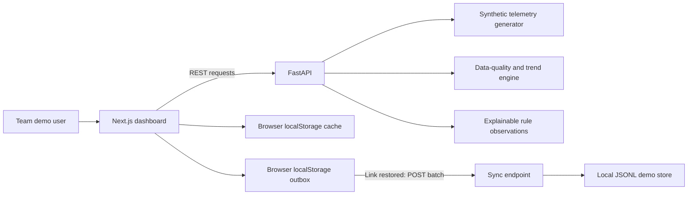

# ASTRA architecture

## Data flow

1. The Next.js dashboard requests mission overview, synthetic telemetry, observations, baseline comparison, and health-analysis output from FastAPI.
2. The browser caches the last successful dashboard snapshot in `localStorage`.
3. During the simulated link outage, the user can add synthetic packets to a browser-side outbox.
4. Restoring the link sends the queued batch to `POST /api/v1/telemetry/sync`.
5. FastAPI validates payload bounds and writes new packet IDs to a local JSONL demo file; repeated IDs are treated as duplicates.

## Prototype constraints

- The crew-health telemetry and alerts remain synthetic. v0.6 adds a live, read-only NASA OSDR study-metadata search; study measurement files are not downloaded or analyzed.
- Browser localStorage is not encrypted and is not a secure medical-data store.
- The local JSONL file is not a production database and has no authentication or multi-user isolation.
- Demo rules and numeric bounds are not clinically validated.
- No operational or clinical decisions should be made from the output.

## NASA research metadata integration (v0.6)

The Next.js dashboard can query the FastAPI endpoint `GET /api/v1/research/osdr?term=...`. The backend requests public study metadata from the NASA OSDR search API, normalizes a small set of metadata fields, and returns source links. Search results are for discovery and citation only; they are not fed into the synthetic telemetry generator or interpreted as clinical evidence. If OSDR is unavailable, the API returns a clear error and the dashboard retains its synthetic-demo functionality.

## v0.7 — Mission event timeline

`GET /api/v1/mission/timeline` derives a chronological sequence of selected synthetic telemetry checkpoints and current rule-based observations. The frontend combines these API-generated events with locally persisted browser events for simulated communication outages, queued packets, and synchronization attempts. The local actions remain browser-specific and are not uploaded as mission audit records. All timeline content is clearly labelled as demonstration data.
